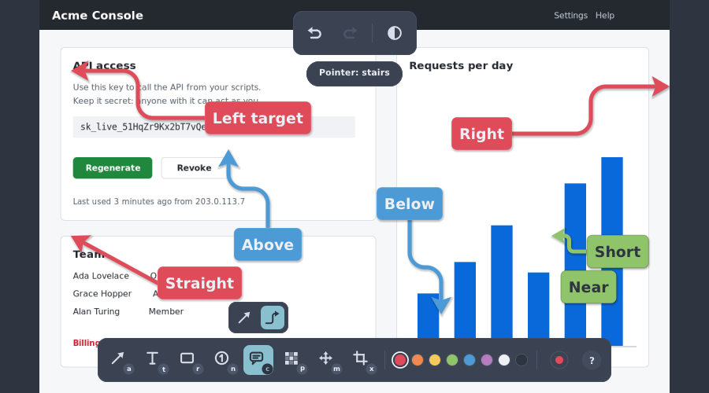

<p align="center">
  
</p>

<h1 align="center">Felt</h1>

<p align="center">
  Fast full-screen screenshot annotation for X11.<br>
  Capture, mark, save. All with one-letter keys.
</p>

<p align="center">
  
</p>

Felt opens an image full screen. You draw on it with one-letter tools, then
save (Ctrl+S) or copy (Ctrl+C). The first frame shows in about 0.1 s, so it fits a
screenshot hotkey. It replaces `ksnip -e` in an i3 setup.

## Features

| Key | Tool |
| --- | --- |
| `c` | Callout: a text box with a pointer (stairs or straight) |
| `a` | Arrow |
| `t` | Text label |
| `r` | Box |
| `n` | Numbered bubble |
| `p` | Pixelate (hide secrets) |
| `m` | Move any annotation |
| `x` | Crop |

- Undo and redo, zoom and pan, 4K-aware UI scale.
- The canvas grows when you draw past the image edge.
- Software renderer: no GPU needed. Pure Zig core with a thin X11 backend.
- A headless mode replays scripts, so every tool has a golden test.

## Install

Needs Zig 0.15.2 (pinned in `mise.toml`), X11 headers (`libx11-dev`,
`libxext-dev`) and, for Ctrl+C, `xclip`.

```sh
mise exec -- zig build -Doptimize=ReleaseFast --prefix ~/.local install
# -> ~/.local/bin/felt
# -> ~/.local/share/applications/felt.desktop and the icons
```

## Use

```sh
felt shot.png            # Ctrl+S overwrites shot.png
felt -e shot.png         # same (ksnip-compatible flag)
felt -o out.png shot.png # Ctrl+S writes out.png
```

The image fits the screen (never upscaled). A small icon dock at the bottom
center shows the tools (each with its key letter), the colors and the size;
click it or use the keys. At startup the callout tool (`c`) is active,
with a stairs pointer: drag from the point of interest to the box and type.
Arrows and callout pointers share one style (stairs or straight): `c` again,
`a` again or the switch above the dock changes it. A small bar at the top
center has Undo and Redo buttons. Tab and Shift+Tab cycle the tools. Space hides or shows both
panels; `?` or F1 shows every shortcut. Crop (`x`) keeps the part you
drag; undo restores it. Move (`m`) drags any annotation; it lights up
under the pointer. A callout box moves alone (the tip stays) or its tip
alone; an arrow end moves alone. Draw past the image edge and the canvas grows
to hold the shape (the saved PNG too); undo shrinks it back. The grown canvas is
light grey or dark grey: `b` or the half-filled circle in the top bar switches
it (a setting, not an undo step). Around a
full-screen image, zoom out with `-` or Ctrl+wheel to get room; `0` fits,
middle drag or the arrow keys pan. The UI and the default sizes scale with the screen
height (2x at 4K). Esc or q quits (q is a letter while you type); with unsaved changes, press it twice. Ctrl+C
counts as saved, because xclip keeps the image in the clipboard after felt
exits.

Full key map: [docs/keymap.md](docs/keymap.md).

### Settings

Felt keeps the canvas background for the next sessions in
`$XDG_CONFIG_HOME/felt/config` (default `~/.config/felt/config`):

```
canvas_bg=dark
```

It writes the file when you switch (`b`), by atomic rename. A missing or
broken file gives the default (`light`). `--canvas-bg light|dark` overrides
the file for one run and does not change it. Headless runs (`--headless`,
tests) never read or write the file.

## i3

Replace the ksnip lines with:

```
bindsym $mod+e exec "felt -e $(/bin/ls -1td /home/mpillet/* | head -n 1)"
for_window [class="felt"] floating enable, fullscreen enable
```

The first line opens the newest file in your home directory (`ls -1td` with a
glob gives full paths, so the working directory of i3 does not matter).
Felt asks for full screen itself; the `for_window` line keeps i3 from
tiling it for a moment. To shoot and annotate in one key:

```
bindsym Print exec "maim -s /tmp/shot.png && felt -o $HOME/shot-$(date +%s).png /tmp/shot.png"
```

## Develop

See [AGENTS.md](AGENTS.md).
